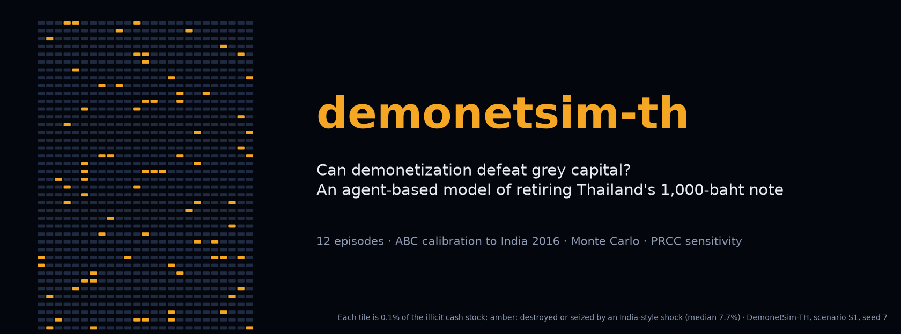
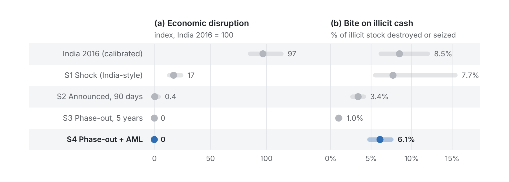

<p align="center"><a href="paper/pdf/paper_en.pdf"></a></p>

<p align="center">
<a href="https://github.com/thanatchon36/demonetsim-th/actions/workflows/ci.yml"></a>
<a href="pyproject.toml"></a>
<a href="https://thanatchon36.github.io/demonetsim-th/paper/"></a>
<a href="paper/pdf/paper_en.pdf"></a>
<a href="paper/pdf/paper_th.pdf"></a>
<a href="#limitations"></a>
<a href="LICENSE"></a>
<a href="https://zenodo.org/badge/latestdoi/1450039515"></a>
<a href="https://huggingface.co/datasets/thanatchon36/demonetsim-th"></a>
</p>

<p align="center">
📖 <b><a href="https://thanatchon36.github.io/demonetsim-th/paper/">Read the paper online</a></b> ·
📄 <b><a href="paper/pdf/paper_en.pdf">Download the PDF</a></b> ·
🇹🇭 <b><a href="paper/pdf/paper_th.pdf">ฉบับภาษาไทย</a></b> ·
📊 <b><a href="results/">Model outputs</a></b> ·
🤗 <b><a href="https://huggingface.co/datasets/thanatchon36/demonetsim-th">Dataset</a></b> ·
🧭 <b><a href="prompts/master_prompt_th.md">Master prompt</a></b>
</p>

**Can demonetization defeat grey capital? An agent-based model of retiring Thailand's 1,000-baht note**, calibrated
to India's 2016 demonetization by approximate Bayesian computation. Illicit holders choose among deposit, structuring
through money mules, conversion into gold, FX or crypto, amnesty and abandonment under capacity-constrained laundering;
honest holders face a liquidity gap governed by replacement logistics. The model runs four Thai scenarios as Monte
Carlo experiments and ranks what drives the results with a global sensitivity analysis.

> งานวิจัยนี้ประเมินข้อเสนอยกเลิกธนบัตร 1,000 บาทเพื่อปราบทุนเทา–ทุนดำ ด้วยบทเรียนจาก 12 กรณีต่างประเทศ
> แบบจำลองตัวแทนที่ปรับเทียบกับอินเดีย 2016 และวาระการวิจัยสำหรับประเทศไทย



> **Data notice.** Statistics on Thailand and on the international episodes are approximations compiled without
> access to live sources, and model parameters are assumptions. Verify them against primary sources, in particular
> Bank of Thailand banknote statistics, before citing the results or using them for policy. The model is a thinking
> tool, not a forecast.

## Key findings

- The 1,000-baht note is worth 0.38% of GDP per capita: a mid-sized "large note", about a quarter of the EUR 500 at its
  withdrawal.
- An India-style shock destroys or seizes a median 7.7% of illicit cash while causing about one sixth of India's
  liquidity disruption, roughly 90% of it borne by vulnerable and informal holders.
- India's 99.3% return rate is consistent with illicit shares from 3% to 29%, so it does not identify the illicit stock.
- The bite of any design hinges on laundering capacity relative to the illicit stock; disruption hinges on replacement
  logistics. A phase-out combined with anti-money-laundering measures bites 6.1% at negligible liquidity cost.

## Install and quickstart

```bash
make setup      # uv venv + dependencies (Python 3.12)
make all        # simulate -> analysis -> figures -> paper (EN + TH) -> web reader
make test       # 21 tests, including the check that results/ carry the numbers the paper quotes
make web        # web reader only (needs pandoc)
```

Without uv: `pip install numpy pandas matplotlib` runs the model; add `weasyprint svglib pypdfium2 Pillow` for the papers.

Outputs: `results/` (CSV, PNG, `prcc_s1.json`, `summary_stats.txt`), `paper/en/figs_en/` (12 vector figures),
`paper/pdf/paper_en.pdf`, `paper/pdf/paper_th.pdf` and the web reader `docs/paper/`.

| Target | Purpose |
|---|---|
| `simulate` | Scenarios, Monte Carlo, ABC calibration and logistics → `results/` (600 draws, seed 7, a few minutes) |
| `analysis` | PRCC global sensitivity, bootstrap standard errors, ABC prior/posterior → `results/prcc_s1.json`, `summary_stats.txt` |
| `figures` | 12 English figures; measures every label with real font metrics and should print `OK` for all 12 |
| `paper-en` | English paper, arXiv preprint format (`pdflatex`) → `paper/pdf/paper_en.pdf` |
| `paper-th` | Thai paper, arXiv preprint format (pandoc → LaTeX → tectonic) → `paper/pdf/paper_th.pdf` |
| `web` | Web reader → `docs/paper/index.html`, served at <https://thanatchon36.github.io/demonetsim-th/paper/> |
| `banner` | README images → `docs/assets/banner.png`, `docs/assets/preview.png` |
| `arxiv` | arXiv upload package → `build/arxiv_source.zip` |

## What the model does

1. **Denomination size** (`denomination_metrics()`, `bulk_table()`): face value relative to GDP per capita for 19
   large notes, and the weight and volume of THB 10 million in each form.
2. **Replacement logistics** (`logistics_mc()`): extra notes, printing cost and the seigniorage shift of replacing the
   1,000s, as a Monte Carlo over the uncertain inputs.
3. **Honest holders** (`honest_side()`): six holder groups convert at a speed set by bank access and scrutiny; the
   liquidity gap $(1-R_0)^2/2r$ depends on replacement currency ready at day 0 and the daily replacement rate.
4. **Illicit holders** (`illicit_side()`): 1,500 agents with heavy-tailed holdings pick the channel with the highest
   retained value; structuring and conversion are capacity-constrained, and overflow agents fall back to their
   next-best option.
5. **Scenarios** (`SCENARIOS`, `monte_carlo()`): S1 shock with a 50-day window, S2 announced 90-day deadline, S3
   five-year phase-out, S4 phase-out with an AML package, 600 draws each.
6. **Calibration** (`abc_india()`): rejection ABC keeps the India 2016 draws whose simulated return rate is within
   0.3 pp of the 99.3% the RBI reported; 1,214 of 4,000 are accepted.
7. **Sensitivity** (`model/analysis.py`): partial rank correlation coefficients for 13 parameters and three outcomes,
   and bootstrap standard errors of every median.

## Research: *Can Demonetization Defeat Grey Capital? Evidence, a Calibrated Agent-Based Model, and a Research Agenda for Retiring Thailand's 1,000-Baht Note*

The preprint by Thanatchon Chongmankhong is in [`paper/`](paper/): the English PDF in
[`paper/pdf/paper_en.pdf`](paper/pdf/paper_en.pdf) with its source [`paper/en/main.tex`](paper/en/main.tex), and the
Thai-language companion by ธนัชชนม์ จงมั่นคง in [`paper/pdf/paper_th.pdf`](paper/pdf/paper_th.pdf), set in the
same arXiv preprint layout from its source [`paper/paper_th.md`](paper/paper_th.md). The paper synthesizes twelve demonetization episodes, formalizes a
*demonetization trilemma* (no design secures bite, smoothness and integrity at once) and proposes three identification
strategies to test whether the 1,000-baht note is in fact a preferred medium of illicit exchange.

- Web reader: <https://thanatchon36.github.io/demonetsim-th/paper/>, rendered from `main.tex` by `paper/build_web.py`
- Figures: [`paper/en/figs_en/`](paper/en/figs_en/) · Model outputs: [`results/`](results/)
- Dataset on Hugging Face: [`thanatchon36/demonetsim-th`](https://huggingface.co/datasets/thanatchon36/demonetsim-th),
  with every model output (Monte Carlo draws, ABC prior and accepted draws, summaries) and the model's input tables;
  rebuilt by `scripts/export_hf.py`

## Repository layout

```
model/
  demonet_sim_th.py         DemonetSim-TH: scenarios, Monte Carlo, ABC calibration, logistics
  analysis.py               PRCC global sensitivity, bootstrap SEs, ABC prior/posterior summary
results/                    model outputs at seed 7 (CSV, PNG, prcc_s1.json, summary_stats.txt)
paper/
  en/main.tex               English paper, arXiv preprint format (pdflatex)
  en/figs_en/               12 vector figures (PDF) and their SVG sources
  figures.py                shared SVG helpers + Thai figure set
  figures_en.py             English figure set + automatic text-overlap checker
  build_th.py               Thai paper builder (paper_th.md -> LaTeX via pandoc -> PDF via tectonic)
  template_th.tex           arXiv preprint layout for the Thai paper (XeTeX)
  fonts/                    Sarabun, the Thai typeface (SIL Open Font License)
  build_web.py              web reader builder (main.tex -> docs/paper/ via pandoc)
  reader.html               pandoc template for the web reader
  paper_th.md               Thai manuscript
  pdf/                      compiled papers: paper_en.pdf, paper_th.pdf
docs/                       GitHub Pages: web reader (paper/) and README images (assets/)
prompts/master_prompt_th.md master prompt used to structure the research (Thai)
scripts/
  check_whitespace.py       measures blank space on every page of a PDF
  make_banner.py            README banner and preview
  make_poster.py            LinkedIn launch poster (docs/assets/linkedin_poster.png)
  export_hf.py, hf_card.md  Hugging Face dataset and its card
tests/                      denominations, model identities and statics, committed results
```

## Requirements

- Python 3.10+ (3.12 with `make setup`); dependencies in [`pyproject.toml`](pyproject.toml).
- A TeX distribution with `pdflatex` and standard packages (mathptmx, natbib, booktabs, tabularx, threeparttable,
  titlesec, fancyhdr, hyperref) for the English paper; [tectonic](https://tectonic-typesetting.github.io/) for the
  Thai paper; pandoc for the Thai paper and the web reader.
- WeasyPrint, for the English figures (`make figures`), needs the Pango system library (version 1.44 or later).
- Fonts: Inter for the English figures; Sarabun for the Thai paper, bundled in `paper/fonts/` (Google Fonts, SIL Open
  Font License).

## Limitations

Statistics are approximations compiled without live sources and model parameters are assumptions; the illicit share
is unknown and India's return rate does not pin it down; the holder groups, laundering capacities and replacement
rates are stylized; references were compiled without database access and their bibliographic details must be
checked. See paper §8.

## AI assistance

The paper, code and figures were drafted with AI assistance (Claude, Anthropic). `prompts/master_prompt_th.md` contains
the master prompt used to structure the research.

## Citation

See [`CITATION.cff`](CITATION.cff); each release is archived on Zenodo (DOI badge above). License: MIT (code);
the Hugging Face dataset is CC BY 4.0.

```bibtex
@misc{chongmankhong2026demonetization,
  author = {Chongmankhong, Thanatchon},
  title  = {Can Demonetization Defeat Grey Capital? Evidence, a Calibrated Agent-Based Model,
            and a Research Agenda for Retiring {Thailand}'s 1,000-Baht Note},
  year   = {2026},
  doi    = {10.5281/zenodo.24050061},
  url    = {https://thanatchon36.github.io/demonetsim-th/paper/},
  note   = {Preprint}
}
```
